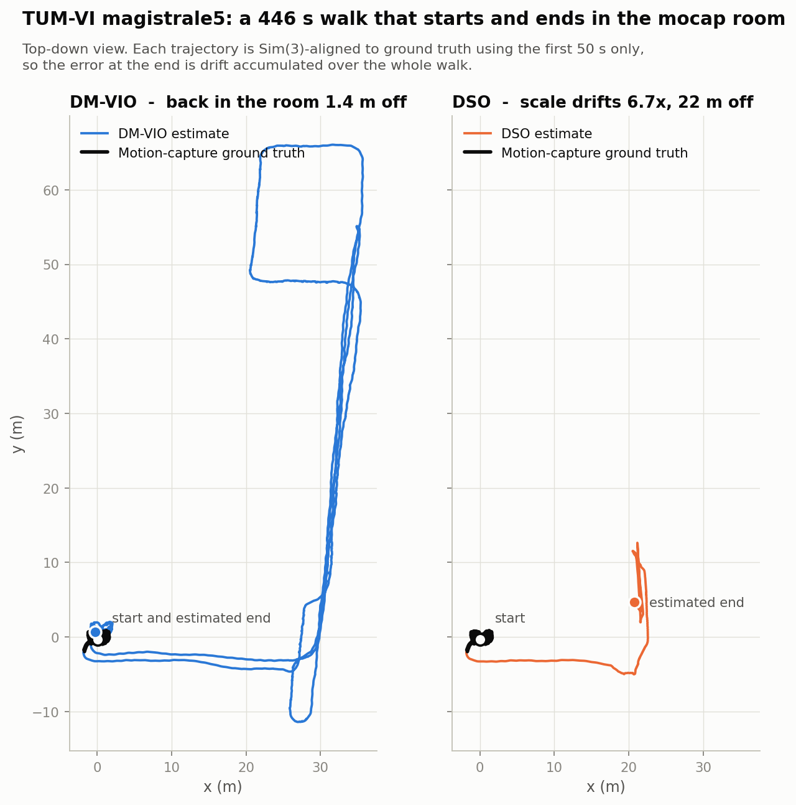
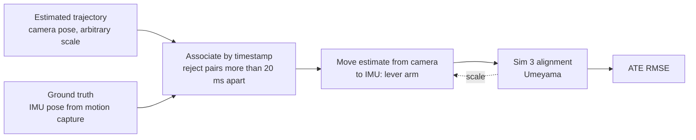
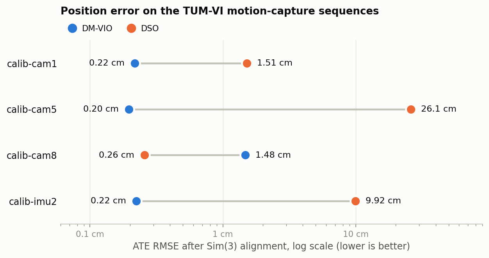
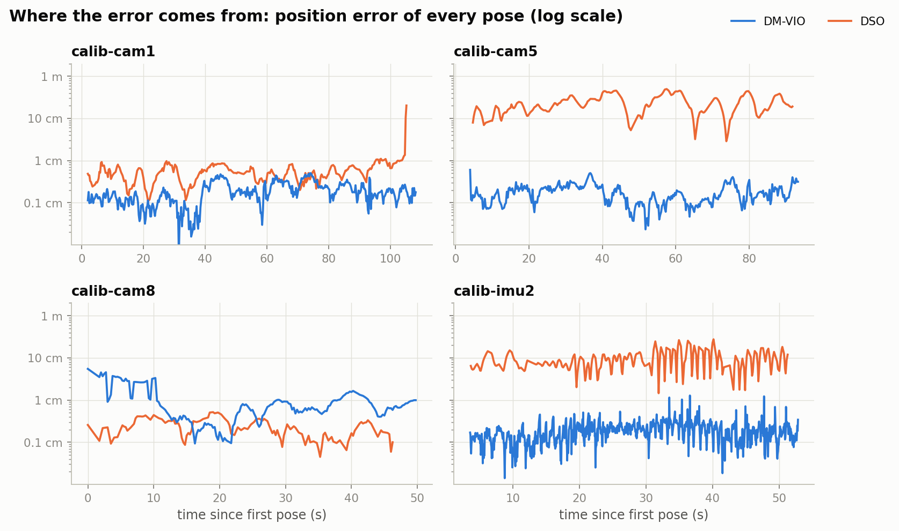
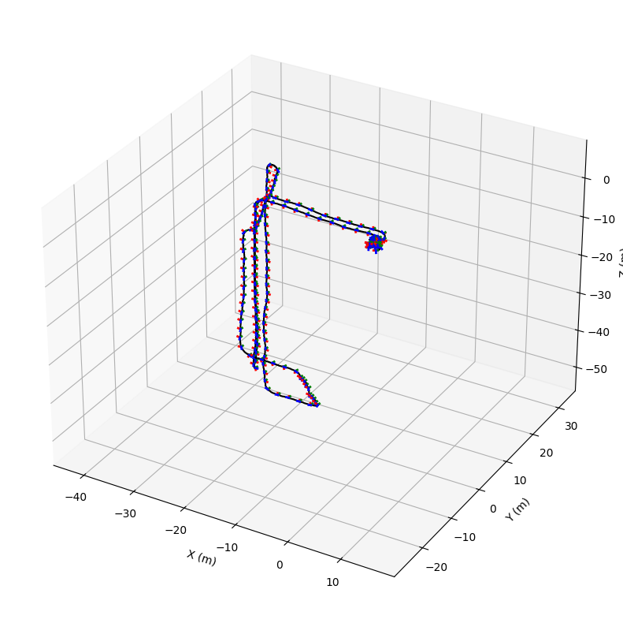
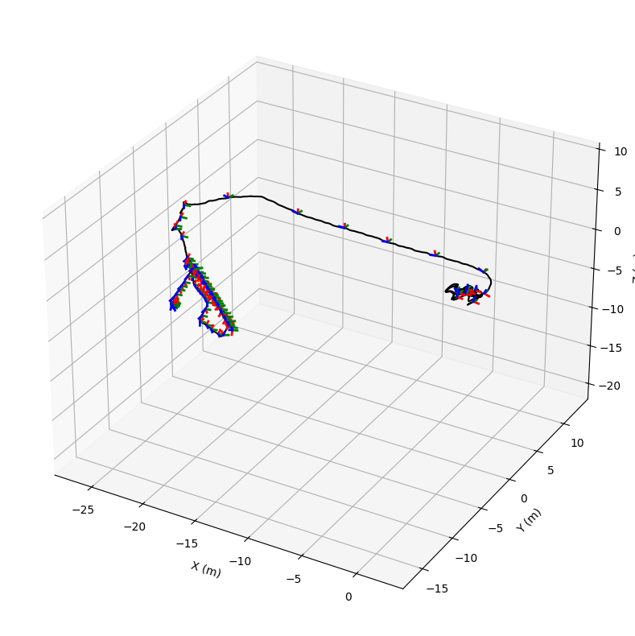
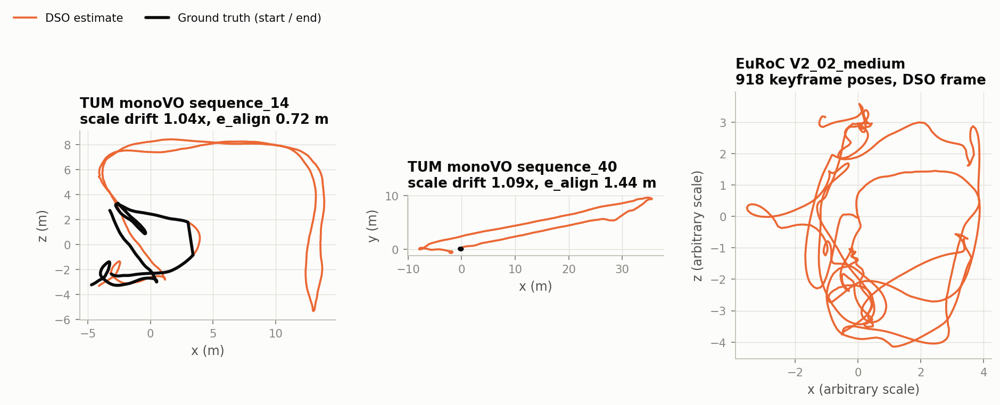

# Monocular VO vs. Visual-Inertial Odometry: DSO against DM-VIO

Mobile Robotics course project (Nov – Dec 2024). I built two direct odometry systems from source, ran them on public benchmarks, and wrote the evaluation that compares them:

- **DSO**, Direct Sparse Odometry: one camera, no other sensor.
- **DM-VIO**, Delayed Marginalization Visual-Inertial Odometry: the same visual front end plus an IMU.

The question is simple: **what does adding an IMU actually buy you?**



On a 7.5-minute handheld walk through a university building (about 440 m), both systems track the whole sequence. But when the camera walks back into the motion-capture room:

| | DM-VIO (camera + IMU) | DSO (camera only) |
| :-- | --: | --: |
| Position error on return | **1.4 m** (about 0.3 % of the path) | 22 m |
| Scale change between start and end | **2 %** | 6.7x |

DSO never lost tracking. It kept producing a smooth, plausible trajectory that was simply the wrong size, which is the failure mode that matters on a robot: nothing tells you it happened.

## Contents

- [What is in this project](#what-is-in-this-project)
- [Background](#background)
- [Building 2016-era code on a current toolchain](#building-2016-era-code-on-a-current-toolchain)
- [How the evaluation works](#how-the-evaluation-works)
- [Results](#results)
- [Limitations](#limitations)
- [Reproducing](#reproducing)
- [Repository layout](#repository-layout)
- [References](#references)

## What is in this project

| Phase | Work | Datasets |
| :-- | :-- | :-- |
| Mid-term | Ported DSO to a current toolchain, ran it, studied its drift | TUM monoVO `sequence_14`, `sequence_40`; EuRoC `V2_02_medium` |
| Final | Built DM-VIO (GTSAM 4.2a6, Pangolin v0.6), ran DSO and DM-VIO on the same sequences, evaluated both against motion-capture ground truth | TUM-VI `calib-cam1/5/8`, `calib-imu2`, `magistrale5` |

Three things here are my own work rather than the original authors':

1. **A patch that makes DSO build** with C++14, OpenCV 4 and a recent Boost ([patches/](patches/)).
2. **An evaluation toolkit** in plain numpy: timestamp association, Sim(3) alignment, camera-to-IMU lever-arm compensation, ATE, and start/end drift metrics ([scripts/](scripts/)).
3. **The stored trajectories and ground truth**, so every number and figure below regenerates in a few seconds without downloading a dataset or building either estimator ([data/](data/)).

## Background

### DSO: direct, sparse, monocular

Feature-based VO extracts keypoints, matches them, and minimises reprojection error. DSO skips all of that and minimises **photometric error** directly: a point seen in a host keyframe should have the same brightness when projected into another frame.

$$E_{\text{photo}} = \sum_{i}\ \sum_{\mathbf{p} \in \mathcal{P}_i}\ \sum_{j \in \text{obs}(\mathbf{p})} \Big\lVert \big(I_j[\mathbf{p}'] - b_j\big) - \frac{t_j e^{a_j}}{t_i e^{a_i}} \big(I_i[\mathbf{p}] - b_i\big) \Big\rVert_{\gamma}$$

- **Sparse:** about 2000 points with enough image gradient, not every pixel.
- **Sliding window:** poses, affine brightness ($a$, $b$), camera intrinsics and one inverse depth per point are jointly optimised over a small window of keyframes.
- **Marginalization:** old keyframes are removed with the Schur complement and leave behind a prior, which keeps the problem small enough for real time.
- **Photometric calibration:** because raw brightness is the measurement, the response function, vignette and exposure time matter. TUM monoVO and TUM-VI provide them; EuRoC does not.

Its limits come from having one camera. Scale is unobservable and free to drift, and tracking has nothing to fall back on when the image is blurred or textureless.

### DM-VIO: what the IMU adds, and why it is hard

An IMU makes scale and the gravity direction observable. The difficulty is *when* to trust it:

- Scale is only observable under acceleration. Initialise too early and a bad scale is baked in.
- Marginalization is permanent. Once a keyframe has been marginalised, its linearization point is frozen inside the prior. If the scale estimate changes later, that prior is inconsistent and cannot be repaired.

DM-VIO's answer is in its name:

| Idea | What it does |
| :-- | :-- |
| **Delayed marginalization** | A second factor graph is kept in which marginalization lags behind by $d$ keyframes ($d = 100$ in the runs here). It retains the old photometric factors, so the prior can be rebuilt with different linearization points or with IMU factors added. |
| **Pose-graph bundle adjustment** | IMU initialization runs on that delayed graph, so scale, gravity direction, velocities and biases are estimated against the full photometric uncertainty rather than fixed visual poses. |
| **Marginalization replacement** | If the scale estimate moves a lot after initialization, the prior is rebuilt instead of living with the stale one. |
| **Dynamic photometric weight** | When image quality drops, the visual term is down-weighted so the IMU carries the estimate. |

The dynamic weight depends on the RMS photometric error $e_{\text{photo}}$ of the current frame, with threshold $\theta = 8$ in these runs:

$$W(e_{\text{photo}}) = \lambda \cdot \begin{cases} \left(\theta / e_{\text{photo}}\right)^2 & e_{\text{photo}} \ge \theta \\ 1 & \text{otherwise} \end{cases}$$

## Building 2016-era code on a current toolchain

DSO targets C++0x and OpenCV 2/3. It did not compile on Ubuntu 22.04 with OpenCV 4.5 and Boost 1.74. The fix is small and is stored as a patch against upstream commit `7b0c99f`: [patches/dso_opencv4_cxx14.patch](patches/dso_opencv4_cxx14.patch).

| File | Problem | Change |
| :-- | :-- | :-- |
| `src/IOWrapper/OpenCV/ImageRW_OpenCV.cpp` | `CV_LOAD_IMAGE_*` constants no longer exist in OpenCV 4 | Replaced with `cv::IMREAD_GRAYSCALE`, `cv::IMREAD_COLOR`, `cv::IMREAD_UNCHANGED` |
| `CMakeLists.txt` | `-std=c++0x` is too old for current Pangolin headers | `CMAKE_CXX_STANDARD 14`, required, extensions off |
| `CMakeLists.txt` | Undefined OpenGL / GLEW / X11 symbols when linking the viewer | `find_package` for all three and explicit linking into `dso_dataset` |
| `src/util/IndexThreadReduce.h` | `boost::bind` is no longer pulled in by `boost/thread.hpp` | Added `#include <boost/bind.hpp>` |

DM-VIO built from upstream commit `e306328` without source changes, against GTSAM `4.2a6` and Pangolin `v0.6`.

## How the evaluation works



Four decisions in this pipeline change the numbers a lot. Each one is something I would expect to be asked about.

**1. Associate with a time gate.** Ground truth exists only while the rig is inside the motion-capture room. On `magistrale5` that is the first and last 50 s of a 446 s sequence. A plain nearest-neighbour match would pair the 345 s in between with whichever ground-truth sample happens to be closest in time, and the error computed from those pairs means nothing. Pairs more than 20 ms apart are dropped.

**2. Align with Sim(3), for both systems.** DSO has no scale, so a similarity transform (rotation, translation, scale) is the only fair alignment. DM-VIO does estimate metric scale, but it writes two files: `result.txt` in the scale-free visual frame and `resultScaled.txt` in metres. The runs archived here kept `result.txt`, so both systems are compared on trajectory *shape* with scale factored out. DM-VIO's metric output is checked separately on the one run where it was kept ([below](#does-dm-vio-recover-metric-scale)).

**3. Compensate the camera-to-IMU lever arm.** The estimators report where the *camera* is. Motion capture reports where the *IMU* is. On the TUM-VI rig these are 9.6 cm apart, so whenever the rig rotates the two trace different paths. The IMU position in the estimator's frame is

$$\mathbf{p}_{\text{imu}} = \mathbf{p}_{\text{cam}} + \frac{1}{s}\, \mathbf{R}_{wc}\, \mathbf{t}_{ci}$$

where $\mathbf{t}_{ci}$ comes from the Kalibr calibration and $s$ is the metres-per-unit scale of the visual frame. That scale is exactly what the Sim(3) alignment estimates, so the two are solved together by fixed-point iteration. It converges in a handful of steps.

This is not a detail. Without it every DM-VIO result on the motion-capture sequences sits at about 4 cm, which is the lever arm and not the estimator:

| Sequence | DM-VIO, raw | DM-VIO, compensated |
| :-- | --: | --: |
| `calib-cam1` | 3.94 cm | 0.22 cm |
| `calib-cam5` | 4.05 cm | 0.20 cm |
| `calib-cam8` | 4.42 cm | 1.48 cm |
| `calib-imu2` | 3.02 cm | 0.22 cm |

**4. Use start/end metrics when ground truth has a hole in it.** For `magistrale5` and TUM monoVO a single ATE over the start and end segments hides the drift, because one global alignment spreads it across both. Following the TUM monoVO protocol, the trajectory is instead aligned to the start segment and, separately, to the end segment:

- **Scale drift** is the ratio of the two fitted scales. 1.0 means the scale never changed.
- **e_align** is the RMSE between the two aligned copies of the whole trajectory. It captures translation, rotation and scale drift together.
- **End error** is the mean position error on the end segment when only the start was used for alignment: how far off you are when you walk back in.

One more thing to know before reading pose counts: **DSO logs keyframes only** (`setting_onlyLogKFPoses = true`), while DM-VIO logs every frame. A shorter DSO file does not mean DSO lost tracking. The tables therefore report *coverage*, the share of the sequence duration spanned by the logged poses.

## Results

All numbers come from `python scripts/evaluate.py` and are also written to [results/metrics.md](results/metrics.md).

### Short sequences with full ground truth

Four TUM-VI calibration recordings made entirely inside the motion-capture room. Position ATE RMSE after Sim(3) alignment with lever-arm compensation.



| Sequence | Length | DM-VIO | DSO | DM-VIO coverage | DSO coverage |
| :-- | --: | --: | --: | --: | --: |
| `calib-cam1` | 109 s | **0.22 cm** | 1.51 cm | 99 % | 97 % |
| `calib-cam5` | 94 s | **0.20 cm** | 26.10 cm | 99 % | 98 % |
| `calib-cam8` | 50 s | 1.48 cm | **0.26 cm** | 99 % | 92 % |
| `calib-imu2` | 53 s | **0.22 cm** | 9.92 cm | 100 % | 97 % |



What the per-pose error shows:

- **DM-VIO is consistent.** Three of four sequences sit at about 2 mm for their whole length.
- **DSO is good or bad, with little in between.** On `calib-cam8` it is excellent. On `calib-cam5` and `calib-imu2` the error is 10 cm or more from start to finish, which means no single similarity transform fits the trajectory: its scale is not constant even over one minute.
- **DSO wins `calib-cam8`.** DM-VIO's error there is concentrated in the first 10 s, at 3 to 5 cm, and drops below 1 cm afterwards. That pattern is consistent with the IMU initialization still converging, and on a 50 s sequence those 10 s dominate the RMSE. Fusing an IMU is not free: it adds an initialization phase that a pure visual system does not have.
- **`calib-imu2` is the clearest case for the IMU.** It is recorded by shaking the rig to excite the IMU, which is hard for a camera and ideal for an accelerometer.

### Long sequence: `magistrale5`

446 s, about 440 m, ground truth for the first and last 50 s only. This is the figure at the top of the page.

| Method | Scale drift | End error (start-aligned) | e_align | Coverage |
| :-- | --: | --: | --: | --: |
| DM-VIO | **1.02x** | **1.41 m** | **2.24 m** | 100 % |
| DSO | 6.68x | 22.35 m | 57.43 m | 100 % |

DSO follows the first corridor correctly and then its scale collapses at the first turn; everything after that is drawn several times too small. Coverage is 100 % for both, so a "frames tracked" metric would have called this a tie.

The same two runs as 3D plots with the camera orientation drawn along the path (unaligned, each in its own frame):

| DM-VIO | DSO |
| :-: | :-: |
|  |  |

### Does DM-VIO recover metric scale?

For one `calib-cam5` run the metric output `resultScaled.txt` was kept. It is already in metres and in the IMU frame, so it is aligned with a rigid SE(3) transform only. Whatever scale a Sim(3) fit still wants to apply is DM-VIO's own scale error.

| Alignment | ATE RMSE | Residual scale error |
| :-- | --: | --: |
| SE(3), no scale correction | 1.56 cm | 4.5 % |
| Sim(3) | 0.32 cm | – |

So with no help from ground truth, DM-VIO's trajectory is within 1.6 cm and its scale within 4.5 %, on a 94 s sequence with 4 Hz images. DSO cannot produce this number at all.

### Mid-term: DSO on its own



| Sequence | Length | Keyframes | Scale drift | e_align | Coverage |
| :-- | --: | --: | --: | --: | --: |
| TUM monoVO `sequence_14` | 62 s | 502 | 1.040x | 0.72 m | 98 % |
| TUM monoVO `sequence_40` | 174 s | 1164 | 1.088x | 1.44 m | 100 % |

On the dataset DSO was designed for, with full photometric calibration, scale drifts by 4 to 9 % over a loop. Compare that with 6.7x on `magistrale5`: the same algorithm, a much longer and harder sequence.

EuRoC `V2_02_medium` ran to completion (918 keyframe poses) and is shown for its shape only. DSO read the images from a plain folder with no timestamp file, so its output carries no timestamps and cannot be associated with ground truth.

## Limitations

- **One run per sequence.** Both systems are multi-threaded and not deterministic. The papers report medians over several runs; these are single samples.
- **Mostly easy sequences.** Four of the five TUM-VI sequences are calibration recordings: short, indoors, in front of a calibration target, and three of them at 4 Hz. `magistrale5` is the only one that resembles real use.
- **Scale is factored out of the main comparison,** because the visual-frame output of DM-VIO was archived rather than the metric one. Metric accuracy is shown on a single run.
- **`calib-cam1` DSO ran without photometric calibration** (`mode=1`); every other TUM-VI run used it.
- **`calib-cam6` is left out.** DSO produced an empty result file and DM-VIO only 85 poses, so there was nothing to compare.
- **Position only.** Rotation error is not evaluated.
- **The estimator binaries were not re-run for this write-up.** The evaluation works from the trajectories saved in December 2024.

What I would do next: re-run everything saving `resultScaled.txt`, do five runs per sequence and report medians, add the TUM-VI `room` and `corridor` sequences, and add relative pose error so drift is measured per metre rather than per sequence.

## Reproducing

### The evaluation and figures (seconds, no build needed)

```bash
git clone https://github.com/ProtonPratt/dso-vs-dmvio-benchmark.git && cd dso-vs-dmvio-benchmark
pip install numpy matplotlib

python scripts/evaluate.py        # prints every table, writes results/metrics.{json,md}
python scripts/make_figures.py    # regenerates figures/*.png
```

A 3D view with orientation frames for any trajectory:

```bash
python scripts/plot_trajectory_3d.py data/tumvi/magistrale5/dmvio_result.txt \
    --every 50 --axis-length 0.5 --save magistrale5_dmvio.png
```

### The estimators (from source)

```bash
sudo apt-get install libsuitesparse-dev libeigen3-dev libboost-all-dev \
                     libopencv-dev libglew-dev libx11-dev libzip-dev libyaml-cpp-dev

# Pangolin v0.6
git clone --branch v0.6 https://github.com/stevenlovegrove/Pangolin.git
cmake -S Pangolin -B Pangolin/build && cmake --build Pangolin/build -j && sudo cmake --install Pangolin/build

# DSO + patch
git clone https://github.com/JakobEngel/dso.git
git -C dso checkout 7b0c99f
git -C dso apply ../patches/dso_opencv4_cxx14.patch
cmake -S dso -B dso/build && cmake --build dso/build -j

# DM-VIO: follow its README (needs GTSAM 4.2a6)
git clone https://github.com/lukasvst/dm-vio.git
```

Then, with a TUM-VI sequence downloaded in its `512_16` export:

```bash
./run/run_dso_tumvi.sh   dso    /data/dataset-magistrale5_512_16
./run/run_dmvio_tumvi.sh dm-vio /data/dataset-magistrale5_512_16 results/magistrale5/
./run/run_dso_midterm.sh dso tum_mono /data/sequence_14
```

To evaluate a new run, copy its result file and `gt_imu.csv` into a folder under `data/tumvi/` and add an entry to [configs/sequences.json](configs/sequences.json).

## Repository layout

```
├── scripts/
│   ├── trajectory_utils.py     I/O, association, Umeyama, lever arm, ATE, drift metrics
│   ├── evaluate.py             runs every sequence, writes results/
│   ├── make_figures.py         regenerates figures/
│   ├── plot_trajectory_3d.py   3D path with camera orientation frames
│   └── resize_images.py        parallel image resizer used for a KITTI experiment
├── configs/
│   ├── sequences.json          which runs to evaluate, lever arm, association gate
│   ├── camchain.yaml           TUM-VI camera-IMU extrinsics (Kalibr)
│   ├── imu_config.yaml         TUM-VI IMU noise model
│   └── euroc_cam0_dso.txt      EuRoC cam0 intrinsics in DSO's calibration format
├── patches/
│   └── dso_opencv4_cxx14.patch DSO build fix, against upstream 7b0c99f
├── run/                        the exact command lines used for each estimator
├── data/                       estimated trajectories and ground truth (8 MB)
│   ├── tumvi/<sequence>/       dmvio_result.txt, dso_result.txt, gt_imu.csv
│   ├── tum_mono/<sequence>/    dso_result.txt, groundtruthSync.txt
│   └── euroc/V2_02_medium/     dso_result.txt
├── results/                    metrics.json, metrics.md
└── figures/                    everything shown in this README
```

Trajectory files are in TUM format: `timestamp x y z qx qy qz qw`.

## References

1. J. Engel, V. Koltun, D. Cremers. *Direct Sparse Odometry.* IEEE TPAMI, 2018. [arXiv:1607.02565](https://arxiv.org/abs/1607.02565)
2. L. von Stumberg, D. Cremers. *DM-VIO: Delayed Marginalization Visual-Inertial Odometry.* IEEE RA-L and ICRA, 2022. [arXiv:2201.04114](https://arxiv.org/abs/2201.04114)
3. D. Schubert, T. Goll, N. Demmel, V. Usenko, J. Stückler, D. Cremers. *The TUM VI Benchmark for Evaluating Visual-Inertial Odometry.* IROS, 2018.
4. J. Engel, V. Usenko, D. Cremers. *A Photometrically Calibrated Benchmark for Monocular Visual Odometry.* [arXiv:1607.02555](https://arxiv.org/abs/1607.02555)
5. M. Burri et al. *The EuRoC Micro Aerial Vehicle Datasets.* IJRR, 2016.
6. S. Umeyama. *Least-Squares Estimation of Transformation Parameters Between Two Point Patterns.* IEEE TPAMI, 1991.

## Acknowledgements and licensing

[DSO](https://github.com/JakobEngel/dso) and [DM-VIO](https://github.com/lukasvst/dm-vio) are the work of their authors at TU Munich and are released under GPLv3. The patch in `patches/` modifies DSO and is under the same licence. Ground-truth files and calibration in `data/` and `configs/` are redistributed from the TUM-VI, TUM monoVO and EuRoC datasets so the evaluation is reproducible; all rights remain with the dataset authors.
